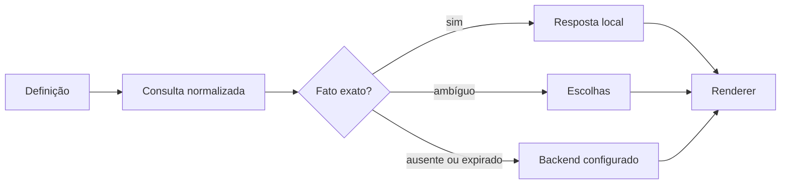

# AgentsChat - Resposta local e escalada

> [!tldr] Em linguagem comum
> Uma pergunta exata é respondida a partir de conhecimento conferido no próprio cliente. Se não houver uma resposta confiável, a aplicação pode chamar o backend autorizado.

← [[00 Hub - agentskit-chat]]

## Passo a passo

| Passo | O que acontece | Quem atua |
|---|---|---|
| Definição | Define comportamento, componentes e políticas comuns. | [[chat]] |
| Conhecimento | Confere formato, integridade e identidade do artefato. | [[chat-protocol]] |
| Resolução | Normaliza a consulta; devolve resposta exata, escolhas ou escalada. | [[chat]] |
| Backend | Recebe a escalada quando configurado e produz resposta transmitida. | [[chat-server]] |
| Interface | Apresenta conteúdo e fontes sem repetir a lógica por framework. | [[chat-react]] |

## Limites e dados

Não há recomendação semântica disfarçada de busca local: miss e conhecimento expirado produzem envelope de escalada. A implantação concreta do Ask do ecossistema está em [[agentskit-ask-backend]]; esta nota descreve o contrato reutilizável.

> [!info]- Detalhe técnico
> - `packages/chat/src/deterministic.ts:53` — resolver local
> - `packages/chat/src/deterministic.ts:85` — stale, miss e ambiguidades
> - `packages/chat/src/deterministic.ts:300` — adaptador com fallback
> - `packages/server/src/ask-service.ts:67` — contratos de autenticação, site, gerador e stores
