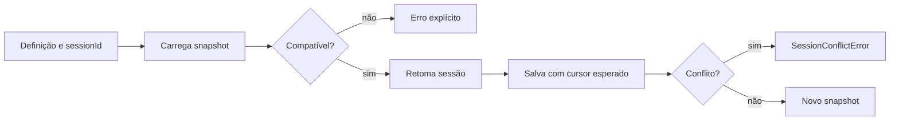

# AgentsChat - Sessão e retomada

> [!tldr] Em linguagem comum
> A conversa guarda não só mensagens, mas também estado e versão da definição. Ao reabrir, o sistema verifica se aquele registro ainda é compatível antes de retomá-lo.

← [[00 Hub - agentskit-chat]]

## Passo a passo

| Passo | O que acontece | Quem atua |
|---|---|---|
| Sessão | Monta uma sessão a partir da definição e opções. | [[chat]] |
| Protocolo | Valida snapshot e versão. | [[chat-protocol]] |
| Armazenamento | Recebe snapshot e cursor esperado; recusa gravação concorrente. | [[chat]] |
| HTTP | Autentica e entrega snapshots e eventos ao cliente quando o host usa servidor. | [[chat-server]] |
| Renderer | Mostra e opera a mesma sessão. | [[chat-react]] |

## Limites e dados

O pacote define interfaces de persistência; isso não prova um banco ativo. O subpath `@agentskit/chat/drizzle-pg` é uma opção pública. Retenção, identidade e recuperação após conflito pertencem à composição do hospedeiro.

> [!info]- Detalhe técnico
> - `agentskit-chat/packages/chat/src/index.ts:579` — storage.save com expectedCursor
> - `agentskit-chat/packages/chat/src/index.ts:690` — createChatSession
> - `agentskit-chat/packages/chat/src/index.ts:766` — salvamento e SessionConflictError
> - `agentskit-chat/packages/chat/src/index.ts:961` — resumeChatSession e checagem de identidade/revisão
> - `agentskit-chat/packages/server/src/index.ts:96` — handler HTTP
