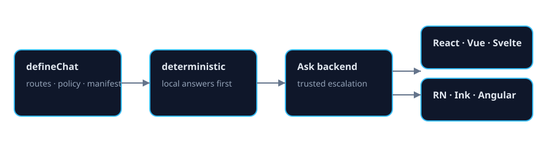
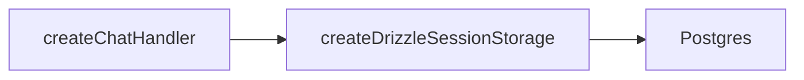

# @agentskit/chat-drizzle-pg

**Profile:** `major-package`

Postgres/Drizzle storage for AgentsKit Chat: session storage and tool-decision store, plus the schema migration. Standalone entry point for `@agentskit/chat/drizzle-pg`; both expose the same API.

## Verified proof

| Surface | Evidence |
|---|---|
| Re-export parity | [`tests/exports.test.ts`](./tests/exports.test.ts) |
| Release path | [release manifest](../../release/manifest.json) |

## Quick start

<!-- readme-command:install-drizzle-pg -->
```bash
npm install @agentskit/chat @agentskit/chat-drizzle-pg drizzle-orm
```

<!-- readme-example:drizzle-pg -->
```ts
import { createDrizzleSessionStorage, migrateChatSchema } from '@agentskit/chat-drizzle-pg'

export { createDrizzleSessionStorage, migrateChatSchema }
```

Requires `drizzle-orm` and `@agentskit/chat` as peer dependencies.





## Maturity and compatibility

Published at `0.7.0`, versioned with `@agentskit/chat`. Release notes are in this package's `CHANGELOG.md`.

- Node.js 22+
- `drizzle-orm` ^0.45.3

## Contributing

Package ownership: `packages/drizzle-pg`. Follow [CONTRIBUTING.md](../../CONTRIBUTING.md).

**Tags:** `agentskit-chat`, `drizzle`, `postgres`, `storage`

## AgentsKit ecosystem

Plugs into the same handlers used in Registry, Playbook, and self-hosted deployments on top of [AgentsKit](https://github.com/AgentsKit-io/agentskit).
